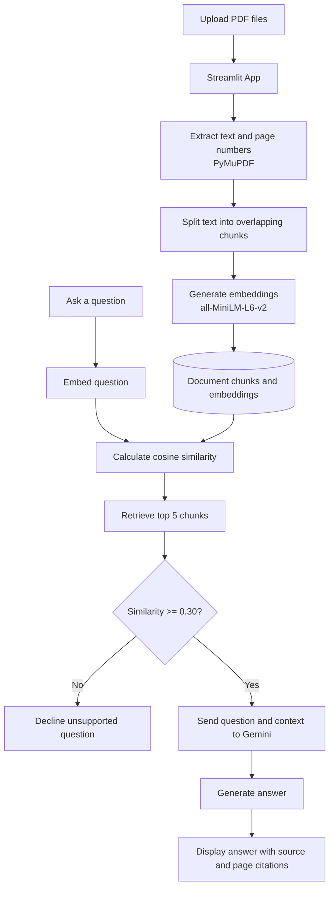

# 🎓 CampusGPT

**Ask questions about your PDFs and get source-backed answers.**

CampusGPT is a Retrieval-Augmented Generation (RAG) application built with Python, Streamlit, sentence-transformers, and the Google Gemini API. Upload one or more PDF documents, ask a question, and receive an answer based on relevant passages retrieved from your documents.

**Live app:** https://campus-gpt-r6ygghnziiuqdu48rhp4yg.streamlit.app/  
**GitHub:** https://github.com/Ayush-1906/CAMPUS-GPT

---

## ✨ Features

- 📄 Upload one or multiple PDF documents.
- 🧩 Extract PDF text and split it into overlapping chunks.
- 🔎 Create embeddings and retrieve relevant chunks using cosine similarity.
- 🤖 Generate answers from retrieved context using Google Gemini.
- 📚 Include source filename and page references in answers.
- 🛑 Refuse unsupported questions when retrieved similarity is below a configured threshold.
- 🧪 Evaluate retrieval decisions and answer-generation behavior with an evaluation script.

## 🛠️ Tech stack

- **Python**
- **Streamlit** — web interface
- **PyMuPDF** — PDF text extraction
- **sentence-transformers** (`all-MiniLM-L6-v2`) — text embeddings
- **NumPy** — numerical operations and similarity calculations
- **Google Gemini API** (`google-genai`) — answer generation
- **python-dotenv** — local environment variable loading

## 🏗️ RAG Architecture



## 🔄 How it works

```text
Upload PDF files
      ↓
Extract text and page information
      ↓
Split text into overlapping chunks
      ↓
Generate embeddings for the chunks
      ↓
Embed the user's question
      ↓
Retrieve the most relevant chunks
      ↓
Check the similarity threshold
      ↓
Generate an answer with Gemini
      ↓
Show the answer with source/page citations
```

CampusGPT uses retrieved PDF content as context for answer generation. The similarity threshold helps the app decline questions when the available documents do not appear relevant enough.

## 🚀 Run locally

### 1. Clone the repository

```bash
git clone https://github.com/Ayush-1906/CAMPUS-GPT.git
cd CAMPUS-GPT
```

### 2. Create and activate a virtual environment

**Windows (PowerShell):**

```powershell
python -m venv .venv
.\.venv\Scripts\Activate.ps1
```

**Windows (Command Prompt):**

```bat
python -m venv .venv
.venv\Scripts\activate
```

**macOS / Linux:**

```bash
python3 -m venv .venv
source .venv/bin/activate
```

### 3. Install dependencies

```bash
python -m pip install --upgrade pip
pip install -r requirements.txt
```

### 4. Configure the Gemini API key

Create a `.env` file in the project root (the same folder as `requirements.txt`) and add:

```dotenv
GEMINI_API_KEY=your_actual_gemini_api_key
```

Get an API key through [Google AI Studio](https://aistudio.google.com/).

**Security:** Never commit `.env` or publish your API key. The repository's `.gitignore` should keep `.env` out of Git.

### 5. Start the app

```bash
streamlit run src/app.py
```

Streamlit will print a local URL, usually `http://localhost:8501`.

## ☁️ Deployment

The application is deployed on Streamlit Community Cloud:

**https://campus-gpt-r6ygghnziiuqdu48rhp4yg.streamlit.app/**

To deploy your own copy:

1. Fork or push the repository to GitHub.
2. In [Streamlit Community Cloud](https://share.streamlit.io/), create an app from the repository.
3. Set the main file path to `src/app.py` and choose the correct branch.
4. In the app's **Settings → Secrets**, add:

   ```toml
   GEMINI_API_KEY = "your_actual_gemini_api_key"
   ```

5. Save the secret and wait for the app to restart.

Do not store secrets in source code or commit them to GitHub.

## 🧪 Evaluation

The repository includes `src/evaluate_rag.py` and `evaluation_questions.json` for checking RAG behavior.

Run the evaluation script from the project root:

```bash
python src/evaluate_rag.py
```

The evaluation script may call the Gemini API, so configure `GEMINI_API_KEY` first. API availability and results can vary between runs.

## 📁 Project structure

```text
CAMPUS-GPT/
├── src/
│   ├── app.py                  # Streamlit application
│   └── evaluate_rag.py         # RAG evaluation script
├── evaluation_questions.json   # Evaluation questions
├── requirements.txt            # Python dependencies
├── .gitignore
└── README.md
```

The exact contents may change as the project evolves. Local generated data and uploaded documents are not intended to be committed to the repository.

## 🔐 Privacy and limitations

- Answers depend on the content and quality of the uploaded PDFs.
- Scanned PDFs without an extractable text layer may not work as expected unless OCR is added.
- RAG can still produce incomplete or incorrect answers; verify important information against the cited pages.
- Uploaded documents are processed by the running app, and relevant text may be sent to the configured Gemini API to generate answers. Do not upload confidential documents unless you understand and accept the applicable service and data policies.
- On the hosted app, upload the PDFs you want to query during your session; local files on the developer's computer are not automatically available in the cloud.

## 🗺️ Possible future improvements

- Add persistent chat history and conversation controls.
- Improve chunking and retrieval evaluation.
- Add a vector database for larger document collections.
- Add OCR support for scanned PDFs.
- Improve UI feedback for indexing, errors, and API failures.
- Add automated tests and a more detailed benchmark dataset.

## 👨‍💻 Author

**Ayush Patil**

- GitHub: [@Ayush-1906](https://github.com/Ayush-1906)

---

If you find CampusGPT useful, consider starring the repository.
